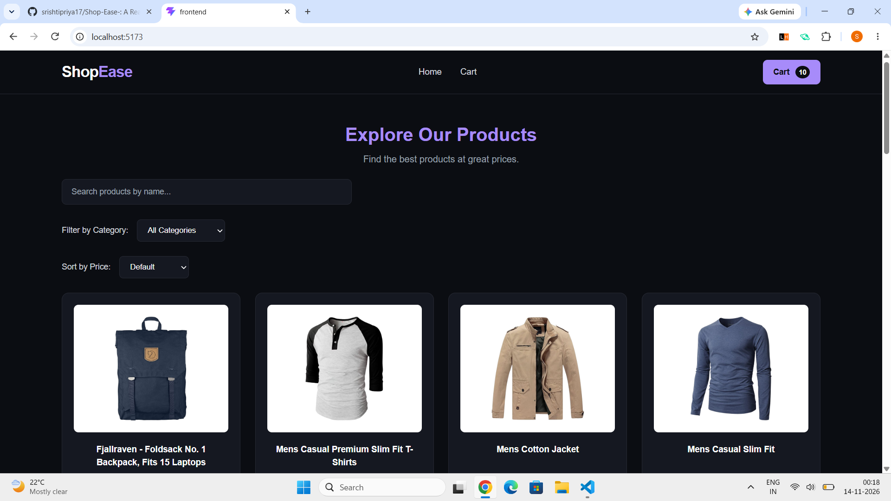
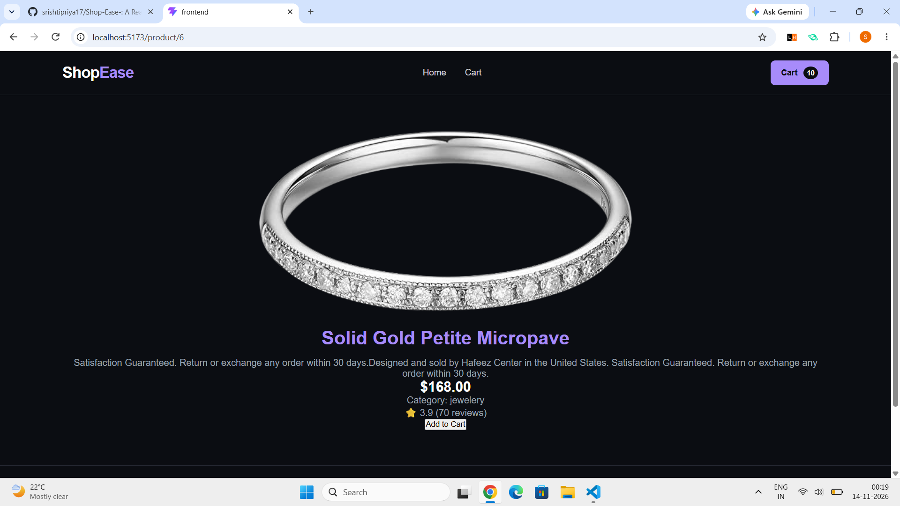
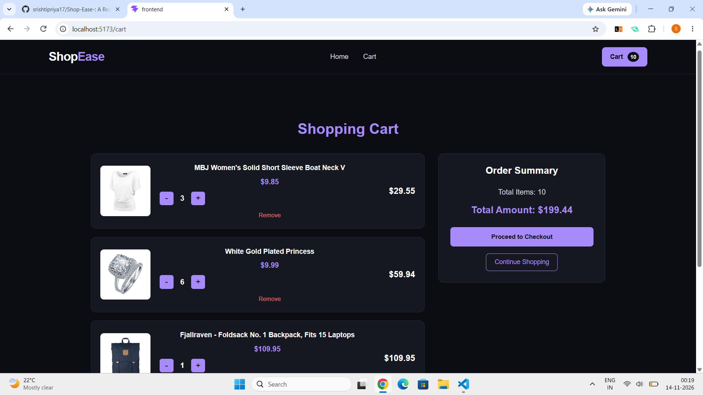

# ShopEase - E-Commerce Website

##  Project Overview

ShopEase is a simple e-commerce website developed using React.js. It allows users to view products, search products, filter products by category and sort them according to price.

Users can also add products to the shopping cart, update product quantities and remove products from the cart.

The website uses the Fake Store API to get product information.

##  Features

- Display all products from the API.
- Search products by their title.
- Filter products by category.
- Sort products by price (Low to High and High to Low).
- View individual product details.
- Add products to the shopping cart.
- Increase and decrease product quantity.
- Remove products from the cart.
- Display total items and total price.
- Save cart data using localStorage.
- Responsive design for different screen sizes.
- Loading and error messages.

##  Technologies Used

- React.js
- JavaScript
- HTML
- CSS
- React Router DOM
- Fake Store API
- Vite
- Git and GitHub

## API Used

This project uses the Fake Store API to fetch product data.

API Link: https://fakestoreapi.com

Endpoints used:

- /products
- /products/:id
- /products/categories

## AI Assistance

During the development of this project, I used AI tools as a supporting resource to improve my coding and development process.

AI assistance was mainly used for:

- **CSS Styling:** Getting suggestions to improve the website's design, layout, spacing, hover effects, and responsive styling.
- **Feature Implementations:** Getting guidance on product filtering and sorting, shopping cart quantity management, and LocalStorage integration.
- **API Integration:** Understanding API requests, handling loading states, and managing errors.
- **Debugging:** Finding and fixing errors during development.
- **Code Understanding:** understanding code logic, and improving implementation.

I reviewed the suggested code, made changes according to my project requirements, and tested the features to understand how they work.

AI was used as a learning and development assistant, while I remained involved in building and understanding the project.

##  Screenshots

### Home Page

### Product Details Page

### Shopping Cart

##  Cart Management

The shopping cart is managed using React useState.

Product quantities can be increased or decreased. Users can also remove products from the cart.

The cart data is stored in localStorage so that it remains available even after refreshing the page.

## Live Demo

Visit the live website: [ShopEase](https://shop-ease-gilt.vercel.app/)

##  Conclusion

ShopEase helped me understand React components, props, state management, React hooks, API integration and routing.

I also learned how to create reusable components and manage shopping cart functionality in a React application.
